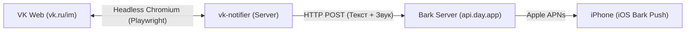

# VK to iOS Push Notifier 📲

[](https://www.python.org/)
[](https://playwright.dev/)
[-000000?logo=apple&logoColor=white)](https://github.com/Finb/Bark)
[](LICENSE)

Автономный сервис для мгновенной доставки Push-уведомлений о личных сообщениях, беседах и статусе «печатает» из ВКонтакте на iPhone через Apple Push Notification service ([Bark](https://github.com/Finb/Bark)).

---

## 💡 Зачем этот проект?

Осенью 2026 года ВКонтакте окончательно заблокировал сторонние токены приложений (Kate Mobile, VFeed и др.) с постоянной ошибкой `Flood Control (code: 9)`. Официальные токены VK Admin привязаны к IP браузера и живут не более 24 часов (`code: 1130`), что делает классические боты на базе VK API непригодными для личных уведомлений.

**VK to iOS Notifier** решает эту проблему в корне:
* Работает напрямую с защищенной веб-версией `vk.ru/im` через полноценный **Google Chrome** (`--headless=new` с маскировкой `playwright-stealth`).
* Не требует ввода логина и пароля в открытом виде — авторизация проходит в 1 клик через **QR-код** и официальное приложение VK на телефоне (с полной поддержкой 2FA).
* Отправляет пуши через открытый легковесный протокол **Bark** прямо в системный шлюз Apple APNs — телефон получает пуш мгновенно даже при выгруженном приложении, экономя заряд аккумулятора.

---

## ⚡️ Возможности

* 💬 **Мгновенные уведомления о ЛС и беседах** — имя собеседника / название чата и превью сообщения (с автоматической очисткой дублирования авторов).
* ⚡️ **Субсекундная доставка пушей** — опрос DOM каждые 600 мс (страховка 2.0 с), неблокирующая асинхронная отправка (`ThreadPoolExecutor`), постоянная keep-alive сессия к Bark API и наивысший приоритет `Time Sensitive` в Apple APNs.
* 🛡 **Глубокий антифрод и Stealth-режим** — эмуляция десктопного окружения Windows 10 x64 / Win32, аппаратный спуфинг WebGL (`NVIDIA GeForce GTX 1660`), таймзона `Europe/Moscow`, сокрытие серверного Linux/SwiftShader и валидные прототипы `PluginArray`.
* ⚡️ **Нативное отслеживание DOM (`MutationObserver`)** — отслеживание входящих сообщений без спама тяжелым DOM-поллингом, экономия ресурсов CPU и естественный браузерный рантайм.
* 🌐 **Поддержка прокси (`VK_PROXY`)** — опциональная маршрутизация браузерного трафика через российские IPv4/резидентские прокси.
* ✍️ **Статус «печатает...»** — отдельный мягкий пуш с кулдауном 3 минуты на диалог, чтобы не спамить.
* 🖼 **Поддержка эмодзи и вложений** — корректный парсинг `alt`-тегов эмодзи, стикеров, фото и голосовых.
* 🛡 **Умная дедупликация (`seen_cache.json`)** — отслеживание диалогов по связке `(snippet, msg_id)` исключает повторные пуши при перезапуске службы, а также полностью подавляет ложные срабатывания при прочтении диалогов пользователем или дребезге веб-разметки.
* 🌐 **Поддержка резидентного прокси (`VK_PROXY`)** — маршрутизация браузерного трафика через российские IPv4-прокси; на практике подтверждена непрерывная работа сессии 3+ суток (80+ часов) без блокировок и сброса авторизации.
* 🌙 **Ночной режим сна (Night Sleep Mode)** — эмуляция естественного человеческого поведения: сервис полностью закрывает Chromium на ночь (по умолчанию 02:00–07:30 MSK) и корректно засыпает, снимая подозрения антифрода в 24/7 удержании сессии.
* 🔄 **Мягкая ротация сессий** — автоматический перезапуск браузерного инстанса каждые 8–12 часов с рандомизированными паузами (15–45 с), предотвращающий утечки памяти и зависания.
* ⏱ **Фильтрация времени** — отсекает относительные плашки (`только что`, `· 2м`), исключая ложные триггеры.
* 🚫 **Игнорирование исходящих** — сообщения, отправленные вами (`Вы: ...`), не порождают уведомлений.
* 🚨 **Детект блокировок и сторож сессии** — немедленный пуш в Bark при возникновении страницы заморозки аккаунта или сброса авторизации (`/?u=2`), предотвращающий холостой ход.
* 🪶 **Альтернативный модуль Web LongPoll** — независимый легкий клиент в `longpoll_client/` (~20 МБ RAM, aiohttp без постоянного браузера).
* ⚙️ **Минимальные ресурсы** — базовый режим ~450 МБ RAM, легковесный режим ~20 МБ RAM.

---

## 🏗 Архитектура



---

## 📋 Системные требования

* **ОС:** Linux (Ubuntu 20.04+, Debian 11+), macOS или любая машина с поддержкой Python и Chromium.
* **Python:** 3.10 или новее.
* **iPhone:** iOS 14.0+ с установленным бесплатным приложением [Bark](https://apps.apple.com/app/bark-customed-notifications/id1403753865) из App Store.
* **Сертификаты:** Корневые сертификаты Минцифры РФ (для беспрепятственного соединения с доменами VK).

---

## 🚀 Быстрый старт

### 1. Клонирование и установка зависимостей

```bash
git clone https://github.com/your-username/vk-ios-notifier.git
cd vk-ios-notifier

# Установка Python пакетов
pip install -r requirements.txt

# Установка headless Chromium и системных библиотек Playwright
playwright install chromium
playwright install-deps chromium
```

> **Примечание по сертификатам (для РФ серверов):**  
> Убедитесь, что в системе установлены доверенные сертификаты (`ca-certificates`). При необходимости добавьте сертификаты Russian Trusted Root CA.

---

### 2. Настройка Bark на iPhone

1. Установите приложение **Bark** из App Store.
2. Откройте приложение и скопируйте персональный ключ устройства (`Device Key`).
3. Создайте файл конфигурации `.env` на основе примера:
   ```bash
   cp .env.example .env
   nano .env
   ```
4. Вставьте ваш ключ (и опционально прокси РФ):
   ```env
   BARK_KEY=ваш_bark_key

   # Опционально: прокси для выхода в VK с российского IP
   # VK_PROXY=http://username:password@ip:port
   ```

---

### 3. Авторизация по QR-коду

Запустите скрипт авторизации:

```bash
python3 src/qr_auth.py
```

1. Скрипт запустит браузер и сохранит изображение QR-кода в `qr.png`.
2. Отсканируйте QR-код в мобильном приложении VK:
   **Сервисы ➔ Настройки (шестерёнка) ➔ QR-код ➔ Сканировать**.
3. Если включена двухфакторная аутентификация (2FA), введите одноразовый код из SMS/приложения прямо в терминал.
4. После подтверждения авторизованная сессия сохранится в файл `session.json`.

---

### 4. Тестовый запуск

Запустите службу в консоли:

```bash
python3 src/web_notifier.py
```

Отправьте себе тестовое сообщение во ВКонтакте с другого аккаунта или попросите друга написать вам. На iPhone должен мгновенно прийти нативный Push-уведомление! Для остановки нажмите `Ctrl + C`.

---

## 🖥 Настройка автозапуска через systemd

Для непрерывной фоновой работы оформите сервис как системного демона:

1. Скопируйте шаблон сервиса:
   ```bash
   cp vk-notifier.service.example /etc/systemd/system/vk-notifier.service
   ```
2. При необходимости отредактируйте пути к директории репозитория и интерпретатору Python:
   ```bash
   nano /etc/systemd/system/vk-notifier.service
   ```
3. Активируйте и запустите службу:
   ```bash
   systemctl daemon-reload
   systemctl enable vk-notifier
   systemctl start vk-notifier
   ```

### Полезные команды управления

* **Просмотр логов в реальном времени:**
  ```bash
  journalctl -u vk-notifier -f
  ```
* **Проверка статуса:**
  ```bash
  systemctl status vk-notifier
  ```
* **Перезапуск сервиса:**
  ```bash
  systemctl restart vk-notifier
  ```

---

## 🧪 Тестирование (E2E и интеграционные тесты)

В репозитории настроен автоматический тестовый контур для валидации всей сквозной цепочки:
- Проверка доступности прокси и совпадения внешнего IP (через `ip-api.com`).
- Проверка отсутствия WAF-блокировок VK (`vk.ru`, `api.vk.ru`).
- Отправка тестового пуша в Bark API.
- Живой headless-запуск Playwright со stealth-профилем и проверка сессии на `vk.ru/im`.
- Сквозной жизненный цикл кэша и дедупликации сообщений.

Запуск всех тестов:
```bash
pytest
```

---

## 🪶 Альтернативный клиент: Web LongPoll (`longpoll_client/`)

Если на сервере ограничена оперативная память, доступен альтернативный модуль:
- Потребляет **~20 МБ RAM** вместо 450 МБ.
- Браузер запускается только один раз на 15 секунд при первоначальном извлечении токена (`python3 -m longpoll_client.auth --browser`).
- Дальнейший мониторинг работает на чистом `aiohttp` сокете.

Подробнее см. в [longpoll_client/README.md](longpoll_client/README.md).

---

## 📊 Потребление ресурсов

| Параметр | Ожидание | Момент получения сообщения / Пуша |
|---|---|---|
| **RAM** | ~450–480 МБ (Python + Headless Chromium) | ~485 МБ |
| **CPU** | 1–2% одного ядра vCPU (интервал 2.5 с) | Краткий всплеск до 15% на 0.2 с |

---

## 🔒 Безопасность и приватность

* **Все данные хранятся только у вас:** Пароли нигде не сохраняются, авторизация держится в локальном файле `session.json`.
* **Никаких сторонних облаков:** Содержимое сообщений передается напрямую между вашим сервером, шлюзом Bark/APNs и вашим личным iPhone.
* **Защита в Git:** Файлы `session.json`, `seen_cache.json`, `.env` и скриншоты по умолчанию добавлены в `.gitignore`.

---

## 📄 Лицензия

Распространяется под лицензией [MIT](LICENSE).
